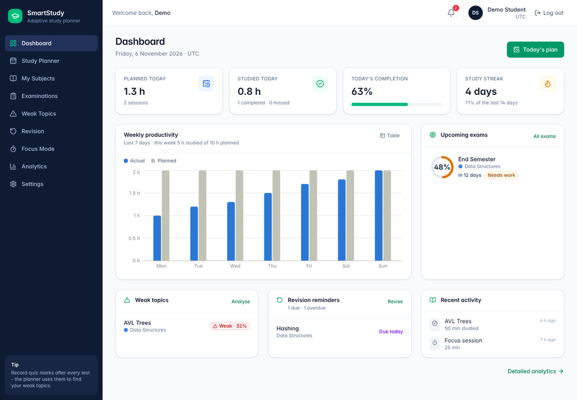
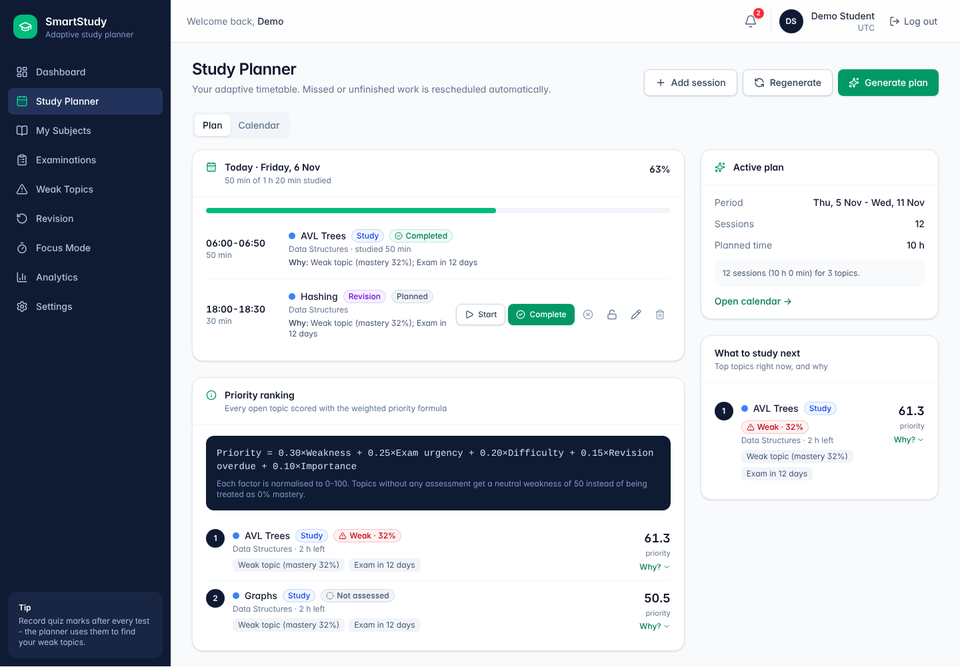
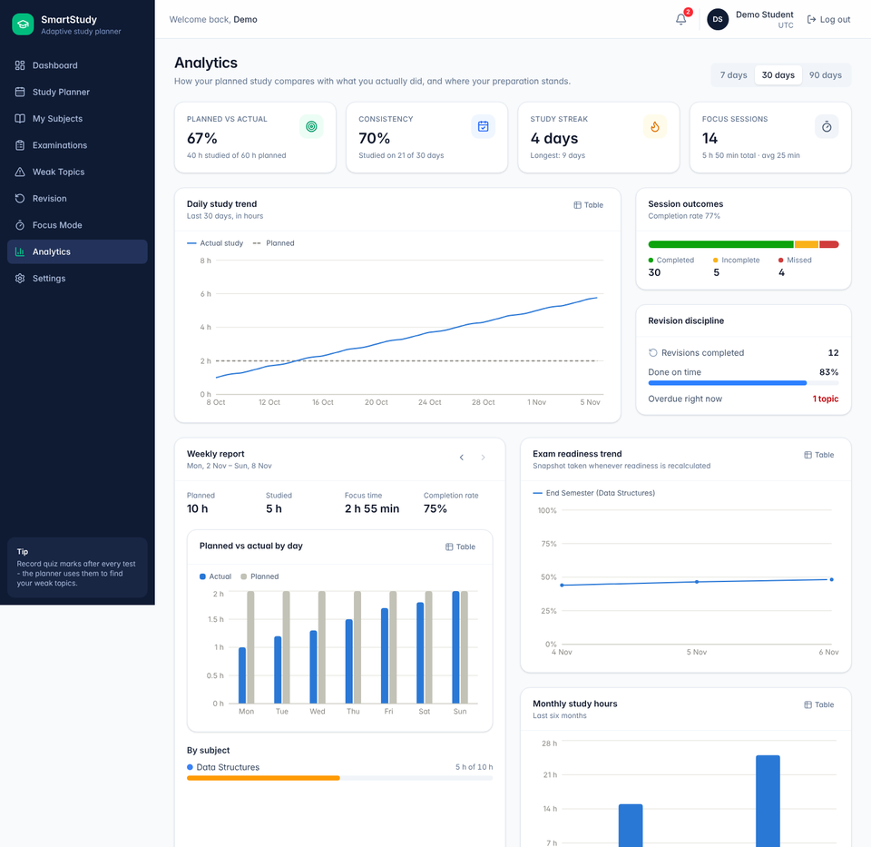
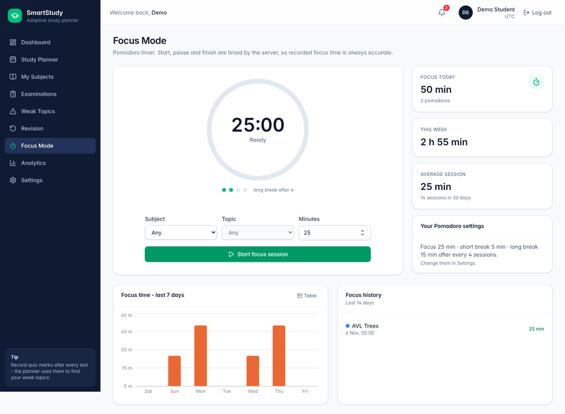

# SmartStudy – Student Study Planner and Progress Tracking System

SmartStudy is a full-stack web application that builds a personalised study timetable for a
student and keeps adapting it: it ranks topics with a weighted priority formula, schedules them
into the student's free time without overlaps, reschedules missed or unfinished work, detects
weak topics from assessment marks, plans revisions with spaced repetition (SM-2), estimates exam
readiness, times Pomodoro focus sessions on the server and shows analytics.

> **Status:** complete source code for all six modules, ready to run locally. Not deployed
> anywhere. See [Verification status](#14-verification-status) for exactly what has been
> tested and what you should run once on your machine.

---

## Contents

1. [Architecture overview](#1-architecture-overview)
2. [Features](#2-features)
3. [Technology stack and exact versions](#3-technology-stack-and-exact-versions)
4. [Project structure](#4-project-structure)
5. [Prerequisites and installation](#5-prerequisites-and-installation)
6. [Set up the database (MySQL Workbench)](#6-set-up-the-database-mysql-workbench)
7. [Open the project in IntelliJ IDEA](#7-open-the-project-in-intellij-idea)
8. [Start the backend](#8-start-the-backend)
9. [Verify the database connection](#9-verify-the-database-connection)
10. [Load the sample data (optional)](#10-load-the-sample-data-optional)
11. [Start the frontend](#11-start-the-frontend)
12. [Test in the browser](#12-test-in-the-browser)
13. [Run the automated tests](#13-run-the-automated-tests)
14. [Verification status](#14-verification-status)
15. [Configuration reference](#15-configuration-reference)
16. [API, Swagger and Postman](#16-api-swagger-and-postman)
17. [Security](#17-security)
18. [Troubleshooting](#18-troubleshooting)
19. [Production build and deployment](#19-production-build-and-deployment)
20. [Further documentation](#20-further-documentation)

---

## 1. Architecture overview

```
┌────────────────────────────┐   JSON over HTTP (/api/v1)    ┌──────────────────────────────────┐
│  React 19 + TypeScript     │  session cookie + CSRF header │  Spring Boot 4.1.2 (Java 25)     │
│  Vite 8, Tailwind CSS 4,   │ ────────────────────────────▶ │  modular monolith                │
│  TanStack Query, Recharts  │ ◀──────────────────────────── │  Spring Security · Spring MVC    │
│  http://localhost:5173     │                               │  Spring Data JPA / Hibernate 7   │
└────────────────────────────┘                               │  http://localhost:8080           │
        (Vite proxies /api to the backend in development)    └────────────────┬─────────────────┘
                                                                              │ JDBC (Connector/J)
                                                              ┌───────────────▼─────────────────┐
                                                              │  MySQL 8.4 – schema by Flyway   │
                                                              └─────────────────────────────────┘
```

* **Backend:** one Spring Boot application, organised by feature (`com.smartstudy.<module>`).
  Each module has its entities, repositories, request/response DTO records, service, controller
  and validation. Entities are never returned by the API. All algorithms live in small,
  framework-free classes with unit tests.
* **Frontend:** a single-page React application. All server data goes through one HTTP client
  (`src/services/http.ts`) that sends the session cookie, adds the CSRF token to every write and
  maps errors.
* **Database:** 14 tables, created and versioned by Flyway. Hibernate never changes the schema.
* **Background job:** every 15 minutes the backend marks overdue sessions as missed,
  reschedules them, creates reminders and stores readiness snapshots.

## 2. Features

| Module | What the student can do |
|---|---|
| **1. Adaptive Study Planner** | Subjects (importance 1–5), topics (difficulty 1–5, estimated time), exam dates, daily/weekly study limits and weekly availability windows. Generates a 1–28 day timetable ranked by `Priority = 0.30·Weakness + 0.25·Urgency + 0.20·Difficulty + 0.15·RevisionOverdue + 0.10·Importance` (each factor normalised to 0–100, weights configurable). No overlaps; manual sessions; lockable sessions; missed and incomplete sessions detected and rescheduled automatically; completed and locked sessions preserved on regeneration; daily, weekly and monthly calendar; "what to study next and why". |
| **2. Weak Topic Detection** | Records exam, quiz, assignment and mock-test marks with per-topic scores. `Mastery = 0.60·Latest + 0.40·HistoricalAverage`; WEAK 0–39, NEEDS IMPROVEMENT 40–64, GOOD 65–79, STRONG 80–100; trends and score history; unassessed topics are shown as "Not assessed", never as 0 %. |
| **3. Revision (SM-2)** | Completed topics enter spaced repetition. Again / Hard / Good / Easy update ease factor, repetitions and interval; due and overdue lists; full revision history with before/after values; local-date boundaries handled. |
| **4. Exam Readiness** | `Readiness = 0.30·Syllabus + 0.30·Mastery + 0.25·MockTests + 0.15·Revision`, pending topics, focus areas, daily snapshots and trend chart. Missing data is reported (SUFFICIENT / PARTIAL / INSUFFICIENT) instead of counted as zero; every view shows that it is an estimate, not a prediction. |
| **5. Focus Mode** | Pomodoro 25/5 with a long break after 4 sessions (all configurable), start / pause / resume / finish / cancel, linked to a subject, topic or study session. Duration is computed by the server from its own timestamps; history and statistics. |
| **6. Analytics** | Daily, weekly and monthly study hours, planned vs actual, completed vs incomplete vs missed, streaks and consistency, subject progress, revision discipline, weak subjects, readiness trends (Recharts). |
| **Notifications** | In-app reminders for today's sessions, missed and rescheduled sessions, due revisions and approaching exams. |

Pages: Login, Register, Dashboard, Study Planner (plan + calendar), My Subjects, Subject detail
(topic management), Examinations, Exam readiness, Weak Topics, Revision, Focus Mode, Analytics,
Settings (profile, Pomodoro, availability, password), Not found.

| Dashboard | Study Planner |
|---|---|
|  |  |
| **Analytics** | **Focus Mode** |
|  |  |

*Screenshots of the production build rendered in Chromium with demo data.*

## 3. Technology stack and exact versions

Backend versions come from the **Spring Boot 4.1.2 dependency BOM** (one compatible set);
the `pom.xml` pins only Spring Boot itself and springdoc.

| Component | Version |
|---|---|
| Java (JDK) | **25** (LTS) |
| Spring Boot | **4.1.2** (Spring Framework 7.0.10, Spring Security 7.1.2, Spring Data 2026.0.2) |
| Hibernate ORM | 7.4.13.Final (managed by Boot) |
| Flyway | 12.4.0 + `flyway-mysql` (managed by Boot) |
| MySQL Connector/J | 9.7.0 (managed by Boot) |
| Jackson | 3.1.7 (managed by Boot) |
| springdoc-openapi (Swagger UI) | **3.2.0** (the release built for Spring Boot 4.1.2) |
| JUnit Jupiter / Mockito / AssertJ | 6.0.3 / 5.23.0 / managed by Boot |
| H2 (tests only, MySQL mode) | 2.4.240 |
| Maven (via Maven Wrapper 3.3.4) | 3.9.11 – downloaded automatically by `mvnw` |
| MySQL Server | **8.4 LTS** |
| Node.js | 22.22+ (24 LTS recommended) |
| React / React DOM | 19.3 |
| TypeScript | 7.0 |
| Vite | 8.3 (+ `@vitejs/plugin-react` 6.1) |
| Tailwind CSS | 4.3 via `@tailwindcss/vite` (CSS-first configuration, no `tailwind.config.js`) |
| React Router | 8.5 |
| TanStack Query | 5.105 |
| Recharts | 3.10 |
| lucide-react (icons) | 1.66 |
| Vitest | 5.0 |

Exact frontend versions are locked in `frontend/package-lock.json`.

## 4. Project structure

```
smartstudy/
├── backend/                              Spring Boot API (Maven project)
│   ├── .mvn/wrapper/maven-wrapper.properties
│   ├── mvnw, mvnw.cmd                    Maven Wrapper (macOS/Linux, Windows)
│   ├── pom.xml
│   └── src/
│       ├── main/java/com/smartstudy/
│       │   ├── SmartStudyApplication.java
│       │   ├── config/        security, CORS, OpenAPI, clock, scheduling, typed properties
│       │   ├── common/        error handling, base entity, time and score helpers, health check
│       │   ├── auth/          register, login, logout, current user, CSRF endpoint
│       │   ├── user/          profile, Pomodoro settings, password, weekly availability
│       │   ├── subject/  topic/  exam/
│       │   ├── planner/       plans, sessions, PlannerService, SessionService
│       │   │   └── engine/    PriorityCalculator, TimetableGenerator (pure algorithms)
│       │   ├── assessment/  performance/      marks, mastery, weak topics
│       │   ├── revision/      SM-2 scheduler and revision log
│       │   ├── readiness/     readiness calculator and snapshots
│       │   ├── focus/         Pomodoro sessions, server-side timing
│       │   ├── analytics/     dashboard, weekly, subjects, productivity
│       │   └── notification/  notifications and the background ReminderScheduler
│       ├── main/resources/
│       │   ├── application.yml, application-dev.yml, application-prod.yml
│       │   └── db/migration/V1__create_core_schema.sql
│       └── test/              unit, Mockito and Spring Boot integration tests (+ application-test.yml)
├── frontend/                             React + TypeScript (Vite)
│   ├── index.html, package.json, package-lock.json, vite.config.ts, vitest.config.ts, tsconfig.json
│   ├── .env.example, .env.demo, vercel.json   (demo build settings for Vercel)
│   ├── public/favicon.svg
│   └── src/
│       ├── main.tsx, App.tsx, index.css (Tailwind 4 theme)
│       ├── components/    ui/ (buttons, cards, forms, modals, feedback), charts/, forms/, sessions/
│       ├── pages/         15 pages (see section 2)
│       ├── layouts/       AppLayout (navy sidebar), AuthLayout
│       ├── services/      http.ts (cookies, CSRF, errors), api.ts (every endpoint)
│       ├── hooks/         queries.ts (TanStack Query), useFocusTimer.ts
│       ├── context/       AuthContext, ToastContext
│       ├── demo/          in-browser sample API, used only by `npm run build:demo` (hosted demo)
│       ├── types/         api.ts (mirrors the backend DTOs)
│       └── utils/         formatting and validation (+ tests)
├── database/
│   ├── create-database.sql               creates the empty database + user (run this)
│   ├── schema.sql                        complete DDL for reference / manual installs
│   └── sample-data.sql                   demo student with realistic data (re-runnable)
├── docs/                                 database design (ERD), API reference, algorithms, deployment, testing
├── postman/                              Postman collection + local environment
├── .env.example                          backend environment variables
├── .gitignore
└── README.md
```

## 5. Prerequisites and installation

Install these once (Windows instructions; macOS/Linux equivalents work the same way).

| Software | Where to get it | Notes |
|---|---|---|
| **JDK 25** | [Eclipse Temurin 25](https://adoptium.net/temurin/releases/?version=25) (or Oracle JDK 25) | In the installer enable **"Set JAVA_HOME"** and **"Add to PATH"**. |
| **Node.js 24 LTS** | [nodejs.org](https://nodejs.org/) | Includes npm. Version 22.22 or newer works. |
| **MySQL Server 8.4 LTS** | [MySQL Community Server](https://dev.mysql.com/downloads/mysql/) → choose **8.4 LTS**, Windows MSI | Remember the **root password** you set during configuration. Keep the default port 3306 and "start at system startup". |
| **MySQL Workbench** | [MySQL Workbench](https://dev.mysql.com/downloads/workbench/) | GUI used in section 6. |
| **IntelliJ IDEA** | [jetbrains.com/idea](https://www.jetbrains.com/idea/download/) | Community or Ultimate, a recent version with Java 25 support (2025.2 or newer). |
| Postman (optional) | [postman.com](https://www.postman.com/downloads/) | For the API collection. |

You do **not** need to install Maven – the Maven Wrapper (`mvnw` / `mvnw.cmd`) downloads
Maven 3.9.11 the first time it runs (internet access required).

**Check the installation** – *Windows PowerShell* (any folder):

```powershell
java -version        # must show version "25..."
node -v              # v22.22 or newer (v24.x recommended)
npm -v
echo $env:JAVA_HOME  # must point to the JDK 25 folder
```

If `java -version` shows an older version, set `JAVA_HOME` to the JDK 25 folder
(Windows: *Settings → System → About → Advanced system settings → Environment Variables*) and
open a new terminal.

## 6. Set up the database (MySQL Workbench)

1. Open **MySQL Workbench** → click the **Local instance MySQL84** connection (user `root`) and
   enter the root password.
2. **File → Open SQL Script…** → select `smartstudy/database/create-database.sql`.
3. Change `ChangeMe_Str0ng!` to a password of your choice (optional for local use, required on
   shared machines). You will use this password as `DB_PASSWORD` in section 8.
4. Click the **lightning icon** (Execute). The output must show `smartstudy` from the last
   statement.

This only creates the **empty** database `smartstudy` and the user `smartstudy`. Do **not**
create tables manually – Flyway creates them when the backend starts (section 8).

> Command-line alternative – *Windows PowerShell* in the `smartstudy` folder:
> `Get-Content database\create-database.sql | mysql -u root -p`

## 7. Open the project in IntelliJ IDEA

1. Unzip the project, e.g. to `C:\Projects\smartstudy`.
2. IntelliJ → **File → Open…** → select the `smartstudy` folder → **Trust Project**.
3. Import the backend as a Maven project: in the Project tool window right-click
   `backend/pom.xml` → **Add as Maven Project** (skip if IntelliJ already shows a *Maven* tool
   window with `smartstudy-backend`). IntelliJ downloads the dependencies – wait until the
   progress bar at the bottom finishes.
4. **File → Project Structure → Project** → *SDK*: select the JDK 25 (add it with
   *Add SDK → JDK…* if needed), *Language level*: **25**.
5. Optional: **Settings → Editor → File Encodings** → UTF-8 everywhere.

The frontend needs no import – IntelliJ recognises `frontend/package.json`.
The **IntelliJ Terminal** (*View → Tool Windows → Terminal*) on Windows is a PowerShell, so
every "PowerShell" command below can be run there.

## 8. Start the backend

The backend reads the database credentials from **environment variables** (no passwords are
stored in the code). In development only `DB_PASSWORD` must be set; `DB_URL` defaults to
`jdbc:mysql://localhost:3306/smartstudy…` and `DB_USERNAME` to `smartstudy`.

### Option A – IntelliJ run configuration (recommended)

1. Open `backend/src/main/java/com/smartstudy/SmartStudyApplication.java` and click the green
   ▶ next to `main` → **Modify Run Configuration…**.
2. **Environment variables** (in Community: *Modify options → Environment variables*):
   `DB_PASSWORD=ChangeMe_Str0ng!` (your password from section 6).
3. Run ▶. The console must show, in this order:

```
Migrating schema `smartstudy` to version "1 - create core schema"
Successfully applied 1 migration to schema `smartstudy`, now at version v1
Tomcat started on port 8080 (http) with context path '/'
Started SmartStudyApplication in … seconds
```

### Option B – IntelliJ Terminal / Windows PowerShell

```powershell
cd C:\Projects\smartstudy\backend
$env:DB_PASSWORD = "ChangeMe_Str0ng!"     # only for this terminal session
.\mvnw.cmd spring-boot:run
```

macOS / Linux (bash): `cd backend && DB_PASSWORD='ChangeMe_Str0ng!' ./mvnw spring-boot:run`

Stop the backend with **Ctrl + C** (terminal) or the red ■ (IntelliJ).

## 9. Verify the database connection

1. **Browser:** open <http://localhost:8080/api/v1/health>. Expected:

```json
{ "status": "UP", "application": "SmartStudy API", "version": "1.0.0", "timestamp": "…",
  "database": { "status": "UP", "product": "MySQL", "productVersion": "8.4.x",
                "databaseName": "smartstudy", "schemaVersion": "1", "message": null } }
```

2. **MySQL Workbench** (new query tab, connection *Local instance*):

```sql
USE smartstudy;
SELECT version, description, success FROM flyway_schema_history;   -- 1 | create core schema | 1
SHOW TABLES;                                                          -- 14 tables + flyway_schema_history
```

3. **Swagger UI:** <http://localhost:8080/swagger-ui.html> lists every endpoint.

## 10. Load the sample data (optional)

After the backend has started **once** (so the tables exist):

*MySQL Workbench* → **File → Open SQL Script…** → `database/sample-data.sql` → Execute.

It creates the demo student **`demo@smartstudy.dev` / `Demo@12345`** with 4 subjects, 20 topics,
5 exams, assessments with topic scores, a timetable around today (completed, missed and planned
sessions), revision history, focus sessions, readiness snapshots and notifications. The script is
re-runnable: it deletes and recreates only the demo student. No restart is needed.

## 11. Start the frontend

Open a **second** terminal tab in IntelliJ (the backend keeps running in the first one):

```powershell
cd C:\Projects\smartstudy\frontend
npm install        # first time only (uses package-lock.json)
npm run dev
```

Open <http://localhost:5173>. Vite forwards every `/api` request to `http://localhost:8080`, so
the browser talks to one origin and the session cookie works without CORS. To use another
backend address, copy `frontend/.env.example` to `frontend/.env.local` and change
`VITE_BACKEND_URL`.

## 12. Test in the browser

With both servers running:

1. <http://localhost:5173> redirects to **Sign in**; the status line under the form shows the
   API as *online* and *MySQL 8.4.x: connected (schema v1)* – this is the frontend → backend →
   MySQL round-trip.
2. Sign in with `demo@smartstudy.dev` / `Demo@12345` (after section 10) – or **Create account**
   (you are taken to *Settings* to enter your study availability).
3. **Dashboard:** today's planned and studied hours, completion %, streak, weekly productivity
   chart, upcoming exams with readiness, weak topics, revision reminders, recent activity.
4. **My Subjects → Add subject**, open it → **Add topic** (difficulty, estimated time).
   Try a duplicate name to see the validation message.
5. **Examinations → Add exam** with a date in the coming weeks.
6. **Settings → Study availability:** add windows (e.g. Mon–Fri 18:00–21:00) → *Save*.
7. **Study Planner → Generate plan:** sessions appear with a *Why* explanation; the priority
   ranking shows the formula and the factor break-down (*Why?*).
8. **Add session** at a time that overlaps an existing one → conflict error. Lock / unlock,
   edit, delete a session.
9. **Complete** a session with fewer minutes than planned (< 80 %) → saved as *Incomplete* and
   the rest is rescheduled. **Mark missed** → a replacement session appears and a notification
   (bell icon) explains where it moved.
10. **Calendar** tab: switch Day / Week / Month.
11. **Weak Topics → Record marks** (e.g. a quiz with per-topic scores) → mastery levels, trends
    and recommendations appear; topics without marks show *Not assessed*.
12. Mark a topic *Completed* → it appears under **Revision** (due tomorrow); **Revise** → choose
    Again / Hard / Good / Easy and see the new interval and ease factor.
13. **Exam readiness** (*Examinations → Readiness dashboard*): overall score, the four
    components, pending topics, focus areas, trend.
14. **Focus Mode:** start a session, pause, resume, finish; the break timer starts and the
    statistics update. Reloading the page keeps the running timer (it comes from the server).
15. **Analytics:** switch 7 / 30 / 90 days; weekly report with previous/next week.
16. **Log out** – then try <http://localhost:5173/planner>: you are sent back to sign in.

## 13. Run the automated tests

*IntelliJ Terminal / PowerShell* in `backend`:

```powershell
.\mvnw.cmd test
```

This runs 97 test methods (unit tests of every algorithm, Mockito service tests and a Spring
Boot integration test on an in-memory H2 database – MySQL does not need to be running).
In IntelliJ you can also right-click `backend/src/test/java` → **Run 'All Tests'**.

*IntelliJ Terminal / PowerShell* in `frontend`:

```powershell
npm test               # Vitest unit tests
npm run typecheck      # strict TypeScript check
npm run build          # type check + production build
```

Test inventory and coverage of the required scenarios: [docs/testing-and-verification.md](docs/testing-and-verification.md).

## 14. Verification status

The project was written in a sandbox where **Maven Central was blocked**, so Maven could not
download the backend dependencies there. Everything else was verified with the real tools:

* All 176 backend Java files compiled with **javac 25** against the official sources of
  Spring Boot 4.1.2 / Framework 7 / Security 7 / Data JPA / Hibernate 7.4 / springdoc 3.2:
  **0 errors**.
* The 8 algorithm test classes run with JUnit 5: **87 / 87 passed**.
* All 50 JPQL queries parsed with Hibernate's own HQL grammar, every path resolved against the
  entities, every entity field matched to a Flyway column, derived query names, bean wiring and
  configuration binding checked: **0 problems**.
* SQL scripts executed on a real MySQL server (8.0.46 – 8.4 packages were not available in the
  sandbox; only syntax common to both is used): create-database → Flyway V1 → sample data **OK**.
* Frontend: strict `tsc`, `vite build` and **15 / 15** Vitest tests pass; all 15 pages rendered
  in Chromium against a mocked API with **no runtime errors**; 10 interactive flows (create
  subject with validation, generate plan, complete session, SM-2 revision, focus start / pause /
  finish / break, notifications) send the expected requests with the CSRF header.
* Every frontend API call (69) matches a backend endpoint, and every TypeScript DTO and enum
  matches the Java records field by field.

**Please run once on your machine:** `.\mvnw.cmd test` (the Mockito and Spring Boot integration
tests were type-checked but not executed in the sandbox) and the startup in section 8. If
anything fails, the [Troubleshooting](#18-troubleshooting) table covers the common causes.

## 15. Configuration reference

All settings are in `backend/src/main/resources/application.yml` and can be overridden with
environment variables. See [`.env.example`](.env.example) for the full list.

| Variable | Default (dev) | Meaning |
|---|---|---|
| `DB_URL` | `jdbc:mysql://localhost:3306/smartstudy?connectionTimeZone=UTC&forceConnectionTimeZoneToSession=true&characterEncoding=UTF-8` | JDBC URL |
| `DB_USERNAME` | `smartstudy` | MySQL user |
| `DB_PASSWORD` | *(none – must be set)* | MySQL password |
| `SERVER_PORT` | `8080` | Backend port |
| `APP_CORS_ALLOWED_ORIGINS` | `http://localhost:5173` | Origins allowed to call the API with cookies |
| `SPRING_PROFILES_ACTIVE` | `dev` | `prod` for production |

Algorithm parameters (priority weights, horizon, planner limits, focus limits) are under
`smartstudy.*` in `application.yml`, e.g.:

```yaml
smartstudy:
  planner:
    weights: { weakness: 0.30, exam-urgency: 0.25, difficulty: 0.20, revision-overdue: 0.15, subject-importance: 0.10 }
```

## 16. API, Swagger and Postman

* Base URL `http://localhost:8080/api/v1`, JSON only. Complete endpoint list, error format and
  request/response examples: [docs/api-reference.md](docs/api-reference.md).
* **Swagger UI:** <http://localhost:8080/swagger-ui.html> (dev profile). For write requests in
  Swagger, first call `GET /auth/csrf` and paste the token into the `X-CSRF-TOKEN` header.
* **Postman:** *Import* `postman/SmartStudy.postman_collection.json` and
  `postman/SmartStudy-local.postman_environment.json`. Run *Auth → Login (demo student)*, then
  any folder. A collection script fetches the CSRF token automatically, and IDs of created
  records are stored in collection variables. The *Security checks* folder demonstrates the
  404 for another student's ID and the 403 without CSRF token. Run *Cleanup* last.

## 17. Security

* Session-based authentication with Spring Security; session cookie `SMARTSTUDY_SESSION` is
  **HttpOnly**, `SameSite=Lax`, `Secure` in production; session id changed on login
  (session-fixation protection); logout invalidates the session.
* **CSRF protection** for every state-changing request (token from `GET /auth/csrf`, sent as
  `X-CSRF-TOKEN`; rotated after login).
* Passwords hashed with **BCrypt** (strength 12); generic "invalid email or password" messages.
* **Ownership validation:** every repository query is filtered by the signed-in student's id;
  another student's id returns **404**, so ids cannot even be probed (covered by tests).
* Bean Validation on every request DTO plus database `CHECK`, `UNIQUE` and foreign-key
  constraints; centralised JSON error handling that never leaks stack traces.
* No SQL string concatenation – only JPQL/derived queries with bound parameters
  (SQL-injection safe).
* CORS restricted to configured origins with credentials; credentials only from environment
  variables; Swagger disabled in production by default.

## 18. Troubleshooting

| Symptom | Cause and fix |
|---|---|
| `'java' is not recognized` or `release version 25 not supported` | JDK 25 not installed or not first in PATH. Install JDK 25, set `JAVA_HOME`, reopen the terminal; in IntelliJ set *Project SDK* = 25 and *Settings → Build → Build Tools → Maven → Runner → JRE* = Project SDK. |
| `The JAVA_HOME environment variable is not defined correctly` (mvnw.cmd) | Set `JAVA_HOME` to the JDK folder (not `…\bin`), reopen the terminal. |
| `mvnw.cmd` cannot download Maven / dependencies | Internet or proxy problem. Behind a proxy configure `%USERPROFILE%\.m2\settings.xml` (`<proxies>`), or in IntelliJ use the bundled Maven via the Maven tool window. |
| Windows asks *How do you want to open this file?* after `.\mvnw` | `mvnw` is the macOS/Linux script – on Windows run `.\mvnw.cmd`. |
| `Access denied for user 'smartstudy'@'localhost'` | `DB_PASSWORD` missing or different from the one in `create-database.sql`. Set it in the run configuration / `$env:DB_PASSWORD`. To reset: Workbench → `ALTER USER 'smartstudy'@'localhost' IDENTIFIED BY 'NewPass';` |
| `Communications link failure` / `Connection refused` | MySQL not running. Windows: *Services* → **MySQL84** → Start (or `net start MySQL84` in an administrator PowerShell). Check the port is 3306. |
| `Unknown database 'smartstudy'` | Section 6 was not run. |
| Flyway: `Found non-empty schema(s) … without schema history table` | Tables were created manually (e.g. by running `schema.sql`). Either drop and recreate the empty database (section 6) or start once with `SPRING_FLYWAY_BASELINE_ON_MIGRATE=true`. |
| Flyway: `Validate failed: Migration checksum mismatch` | An applied migration file was edited. Restore it; add changes as a new `V2__…sql`. In development you can drop and recreate the database. |
| `Port 8080 was already in use` | Another program uses 8080. Stop it or set `SERVER_PORT=8081` and `VITE_BACKEND_URL=http://localhost:8081` in `frontend/.env.local`. |
| Login page shows the API as *offline* | Backend not running or on another port; check <http://localhost:8080/api/v1/health>. |
| `403` with `CSRF_INVALID` in Postman/curl | Fetch `GET /auth/csrf` with the same cookie jar and send the token as `X-CSRF-TOKEN`; fetch a new token after login. |
| Always signed out after login (custom setup) | Frontend and API on different sites. Use the Vite proxy (dev) or one domain behind a reverse proxy (prod); see [docs/deployment.md](docs/deployment.md#6-frontend-and-api-on-different-domains-optional). |
| `npm install` fails with `EBADENGINE` / Vite error about Node | Node too old – install Node 24 LTS. |
| `npm run dev`: port 5173 in use | Vite picks the next free port automatically; or stop the other process. If it changes, add the new origin to `APP_CORS_ALLOWED_ORIGINS` only if you bypass the proxy. |
| Planner says *no availability* / generates nothing | Add study windows in *Settings → Study availability*; check daily/weekly limits are > 0; topics need remaining estimated time; exams must be in the future. |
| Sessions appear at the wrong hour | Set the correct time zone in *Settings* (times are stored in UTC and shown in your zone). |
| Sample data: `Table 'smartstudy.users' doesn't exist` | Start the backend once before running `sample-data.sql`. |
| IntelliJ shows red imports in the backend | Maven project not imported or still downloading: Maven tool window → *Reload All Maven Projects*. |

## 19. Production build and deployment

```powershell
cd backend;  .\mvnw.cmd clean package      # → backend\target\smartstudy-backend-1.0.0.jar
cd ..\frontend; npm ci; npm run build      # → frontend\dist\
```

Run the JAR with `SPRING_PROFILES_ACTIVE=prod` and `DB_URL`, `DB_USERNAME`, `DB_PASSWORD`;
serve `frontend/dist` and proxy `/api` to the backend from the same domain. Production
environment variables, the database migration process, an Nginx + systemd example, hosting the
frontend, backend and MySQL separately, and a go-live checklist are in
[docs/deployment.md](docs/deployment.md).

### Hosted demo on Vercel (frontend only, sample data)

Vercel cannot run the Java backend or MySQL, so the repository includes a **demo build** of the
frontend that answers every API call in the browser with sample data
(`frontend/src/demo/mockServer.ts`, same formulas as the backend; changes reset on reload).
It is enabled only by `npm run build:demo` (`--mode demo` → `frontend/.env.demo`); normal builds
do not contain it.

Vercel settings when importing the GitHub repository:

| Setting | Value |
|---|---|
| Root Directory | `frontend` |
| Application Preset | `Vite` |
| Build / Output | taken from `frontend/vercel.json` (`npm run build:demo`, `dist`, SPA rewrites) |
| Environment Variables | none |

Sign in on the deployed site with `demo@smartstudy.dev` / `Demo@12345`.

## 20. Further documentation

| Document | Content |
|---|---|
| [docs/database-design.md](docs/database-design.md) | Mermaid ERD, table relationships, constraints, cascade rules |
| [docs/algorithms.md](docs/algorithms.md) | Priority, timetable, rescheduling, mastery, SM-2, readiness and focus formulas with worked examples |
| [docs/api-reference.md](docs/api-reference.md) | Every endpoint, error codes, JSON examples, curl and PowerShell examples |
| [docs/testing-and-verification.md](docs/testing-and-verification.md) | Test inventory and verification report |
| [docs/deployment.md](docs/deployment.md) | Production configuration and hosting guide |
| [postman/](postman/) | Postman collection and environment |
