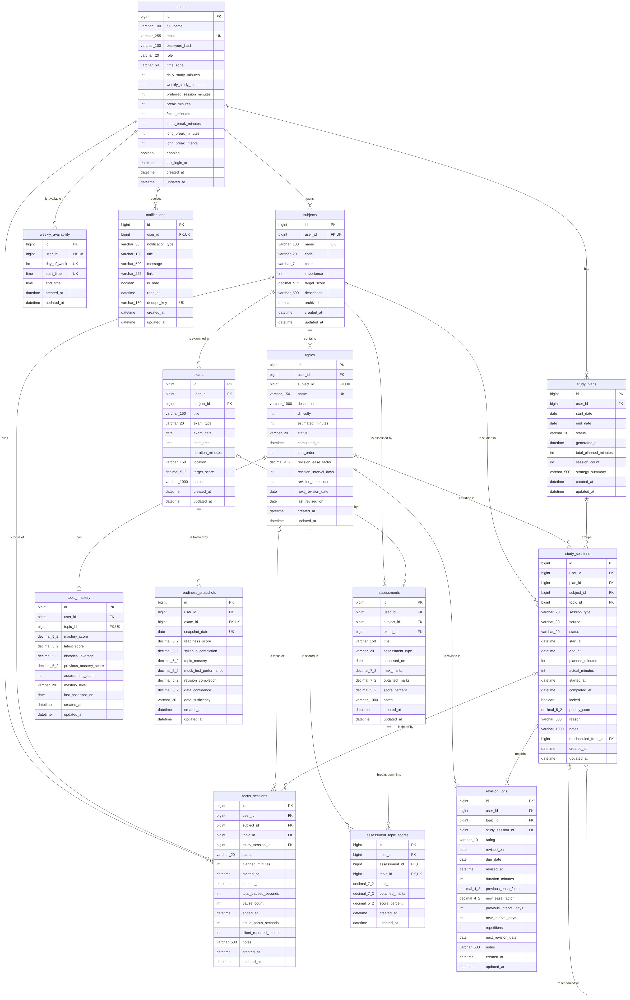

# SmartStudy – Database Design

MySQL 8.4, InnoDB, `utf8mb4` / `utf8mb4_0900_ai_ci`. The schema is owned by **Flyway**
(`backend/src/main/resources/db/migration/V1__create_core_schema.sql`); Hibernate runs with
`ddl-auto: none` and never changes tables. `database/schema.sql` is the same DDL with a header
that creates the database and the application user, for reading or manual installation.

## Design rules

| Rule | How it is applied |
|---|---|
| Surrogate keys | `BIGINT AUTO_INCREMENT` primary key `id` on every table |
| Data isolation | Every student-owned table carries `user_id`; every repository query filters by it, so a student can never reach another student's row by changing an ID (the API answers 404) |
| Referential integrity | 30 foreign keys. Owned data uses `ON DELETE CASCADE`; optional links (plan, exam, rescheduled-from, linked study session) use `ON DELETE SET NULL` so history survives |
| Domain validation in the database | 49 `CHECK` constraints (ranges such as difficulty 1–5, enum values, `end_at > start_at`, `obtained_marks <= max_marks`) – a second line of defence behind Bean Validation |
| Uniqueness | email; subject name per student; topic name per subject; one availability window start per day; one mastery row per topic; one topic score per assessment; one readiness snapshot per exam per day; notification de-duplication key per student |
| Time | All `DATETIME(6)` values are UTC instants (JDBC `connectionTimeZone=UTC`, `hibernate.jdbc.time_zone=UTC`). `DATE` / `TIME` columns are local calendar values in the student's time zone (`users.time_zone`) |
| Auditing | `created_at` / `updated_at` on every table (set by the JPA base entity) |
| Indexes | Composite indexes that start with `user_id` for every dashboard/calendar query (e.g. `study_sessions (user_id, start_at)`, `topics (user_id, next_revision_date)`, `notifications (user_id, is_read, created_at)`) |
| Unassessed is not zero | A topic without assessment scores simply has **no** `topic_mastery` row; it is shown as "Not assessed" and never counted as 0 % |

## Entity-relationship diagram

Mermaid source (renders on GitHub and in IntelliJ's Markdown preview). Every student-owned table
also has `user_id → users.id ON DELETE CASCADE`; those lines are drawn only for tables whose
parent is the student directly, to keep the diagram readable.

```mermaid
erDiagram
    users ||--o{ subjects : "owns"
    users ||--o{ weekly_availability : "is available in"
    users ||--o{ study_plans : "has"
    users ||--o{ focus_sessions : "runs"
    users ||--o{ notifications : "receives"
    subjects ||--o{ topics : "contains"
    subjects ||--o{ exams : "is examined in"
    subjects ||--o{ study_sessions : "is studied in"
    subjects ||--o{ assessments : "is assessed by"
    subjects |o--o{ focus_sessions : "is focus of"
    topics ||--o| topic_mastery : "has"
    topics |o--o{ study_sessions : "is studied in"
    topics ||--o{ assessment_topic_scores : "is scored in"
    topics ||--o{ revision_logs : "is revised in"
    topics |o--o{ focus_sessions : "is focus of"
    study_plans |o--o{ study_sessions : "groups"
    study_sessions |o--o{ study_sessions : "rescheduled as"
    study_sessions |o--o{ revision_logs : "records"
    study_sessions |o--o{ focus_sessions : "is timed by"
    exams |o--o{ assessments : "is prepared by"
    exams ||--o{ readiness_snapshots : "is tracked by"
    assessments ||--o{ assessment_topic_scores : "breaks down into"
    users {
        bigint id PK
        varchar_100 full_name
        varchar_255 email UK
        varchar_100 password_hash
        varchar_20 role
        varchar_64 time_zone
        int daily_study_minutes
        int weekly_study_minutes
        int preferred_session_minutes
        int break_minutes
        int focus_minutes
        int short_break_minutes
        int long_break_minutes
        int long_break_interval
        boolean enabled
        datetime last_login_at
        datetime created_at
        datetime updated_at
    }
    subjects {
        bigint id PK
        bigint user_id FK, UK
        varchar_100 name UK
        varchar_20 code
        varchar_7 color
        int importance
        decimal_5_2 target_score
        varchar_500 description
        boolean archived
        datetime created_at
        datetime updated_at
    }
    topics {
        bigint id PK
        bigint user_id FK
        bigint subject_id FK, UK
        varchar_150 name UK
        varchar_1000 description
        int difficulty
        int estimated_minutes
        varchar_20 status
        datetime completed_at
        int sort_order
        decimal_4_2 revision_ease_factor
        int revision_interval_days
        int revision_repetitions
        date next_revision_date
        date last_revised_on
        datetime created_at
        datetime updated_at
    }
    weekly_availability {
        bigint id PK
        bigint user_id FK, UK
        int day_of_week UK
        time start_time UK
        time end_time
        datetime created_at
        datetime updated_at
    }
    exams {
        bigint id PK
        bigint user_id FK
        bigint subject_id FK
        varchar_150 title
        varchar_20 exam_type
        date exam_date
        time start_time
        int duration_minutes
        varchar_150 location
        decimal_5_2 target_score
        varchar_1000 notes
        datetime created_at
        datetime updated_at
    }
    study_plans {
        bigint id PK
        bigint user_id FK
        date start_date
        date end_date
        varchar_20 status
        datetime generated_at
        int total_planned_minutes
        int session_count
        varchar_500 strategy_summary
        datetime created_at
        datetime updated_at
    }
    study_sessions {
        bigint id PK
        bigint user_id FK
        bigint plan_id FK
        bigint subject_id FK
        bigint topic_id FK
        varchar_20 session_type
        varchar_20 source
        varchar_20 status
        datetime start_at
        datetime end_at
        int planned_minutes
        int actual_minutes
        datetime started_at
        datetime completed_at
        boolean locked
        decimal_5_2 priority_score
        varchar_500 reason
        varchar_1000 notes
        bigint rescheduled_from_id FK
        datetime created_at
        datetime updated_at
    }
    assessments {
        bigint id PK
        bigint user_id FK
        bigint subject_id FK
        bigint exam_id FK
        varchar_150 title
        varchar_20 assessment_type
        date assessed_on
        decimal_7_2 max_marks
        decimal_7_2 obtained_marks
        decimal_5_2 score_percent
        varchar_1000 notes
        datetime created_at
        datetime updated_at
    }
    assessment_topic_scores {
        bigint id PK
        bigint user_id FK
        bigint assessment_id FK, UK
        bigint topic_id FK, UK
        decimal_7_2 max_marks
        decimal_7_2 obtained_marks
        decimal_5_2 score_percent
        datetime created_at
        datetime updated_at
    }
    topic_mastery {
        bigint id PK
        bigint user_id FK
        bigint topic_id FK, UK
        decimal_5_2 mastery_score
        decimal_5_2 latest_score
        decimal_5_2 historical_average
        decimal_5_2 previous_mastery_score
        int assessment_count
        varchar_20 mastery_level
        date last_assessed_on
        datetime created_at
        datetime updated_at
    }
    revision_logs {
        bigint id PK
        bigint user_id FK
        bigint topic_id FK
        bigint study_session_id FK
        varchar_10 rating
        date revised_on
        date due_date
        datetime revised_at
        int duration_minutes
        decimal_4_2 previous_ease_factor
        decimal_4_2 new_ease_factor
        int previous_interval_days
        int new_interval_days
        int repetitions
        date next_revision_date
        varchar_500 notes
        datetime created_at
        datetime updated_at
    }
    focus_sessions {
        bigint id PK
        bigint user_id FK
        bigint subject_id FK
        bigint topic_id FK
        bigint study_session_id FK
        varchar_20 status
        int planned_minutes
        datetime started_at
        datetime paused_at
        int total_paused_seconds
        int pause_count
        datetime ended_at
        int actual_focus_seconds
        int client_reported_seconds
        varchar_500 notes
        datetime created_at
        datetime updated_at
    }
    notifications {
        bigint id PK
        bigint user_id FK, UK
        varchar_30 notification_type
        varchar_150 title
        varchar_500 message
        varchar_255 link
        boolean is_read
        datetime read_at
        varchar_150 dedupe_key UK
        datetime created_at
        datetime updated_at
    }
    readiness_snapshots {
        bigint id PK
        bigint user_id FK
        bigint exam_id FK, UK
        date snapshot_date UK
        decimal_5_2 readiness_score
        decimal_5_2 syllabus_completion
        decimal_5_2 topic_mastery
        decimal_5_2 mock_test_performance
        decimal_5_2 revision_completion
        decimal_5_2 data_confidence
        varchar_20 data_sufficiency
        datetime created_at
        datetime updated_at
    }
```

## Tables

| # | Table | Purpose | Key relationships |
|---|---|---|---|
| 1 | `users` | Student account: credentials (BCrypt hash), time zone, study-time budgets and Pomodoro settings | Parent of everything |
| 2 | `subjects` | A course/subject with colour, importance (1–5) and optional target score | `users` 1–N; unique `(user_id, name)` |
| 3 | `topics` | Unit of study: difficulty (1–5), estimated minutes, status, SM-2 revision state (`revision_ease_factor`, `revision_interval_days`, `revision_repetitions`, `next_revision_date`) | `subjects` 1–N; unique `(subject_id, name)` |
| 4 | `weekly_availability` | Study windows per weekday (1 = Monday … 7 = Sunday) in local time | `users` 1–N |
| 5 | `exams` | Exam dates per subject (type, date, time, target) – drive exam urgency and readiness | `subjects` 1–N |
| 6 | `study_plans` | One generated planning run (period, strategy summary). Older plans are `ARCHIVED` | `users` 1–N |
| 7 | `study_sessions` | Every scheduled block: type `STUDY/REVISION/PRACTICE`, source `GENERATED/MANUAL`, status, UTC start/end, planned/actual minutes, `locked`, priority score and human-readable reason | `study_plans` (SET NULL), `subjects`, `topics`, self-reference `rescheduled_from_id` |
| 8 | `assessments` | Quiz / exam / assignment / mock-test result for a subject | `subjects` 1–N, optional `exams` (SET NULL) |
| 9 | `assessment_topic_scores` | Per-topic break-down of an assessment – the input for mastery | `assessments` 1–N, `topics` 1–N |
| 10 | `topic_mastery` | Current mastery per assessed topic: latest, historical average, previous score, level | `topics` 1–1 |
| 11 | `revision_logs` | Every SM-2 review: rating, due vs. actual date, ease factor and interval before/after | `topics` 1–N, optional `study_sessions` |
| 12 | `focus_sessions` | Pomodoro sessions with server timestamps (start, pause, total paused seconds, end) | optional `subjects`, `topics`, `study_sessions` |
| 13 | `notifications` | In-app reminders (sessions today, missed and rescheduled, revisions due, exams approaching) with a de-duplication key | `users` 1–N |
| 14 | `readiness_snapshots` | Daily exam-readiness score with all four components and the data-confidence level, for trend charts | `exams` 1–N; unique `(exam_id, snapshot_date)` |

## Cascade behaviour (what happens on delete)

* **Delete a student** → everything owned by the student is removed (all FKs to `users` cascade).
* **Delete a subject** → its topics, exams, sessions and assessments are removed; focus sessions keep their time but lose the subject link.
* **Delete a topic** → its sessions, scores, mastery and revision logs are removed.
* **Delete an exam** → its readiness snapshots are removed; assessments linked to it stay (link set to NULL).
* **Delete a plan** → its sessions stay (they lose the plan link).

## Migrations

| Version | File | Content |
|---|---|---|
| V1 | `V1__create_core_schema.sql` | All 14 tables, constraints and indexes |

To change the schema later, add `V2__description.sql` – never edit an applied migration
(Flyway validates checksums on start-up).
